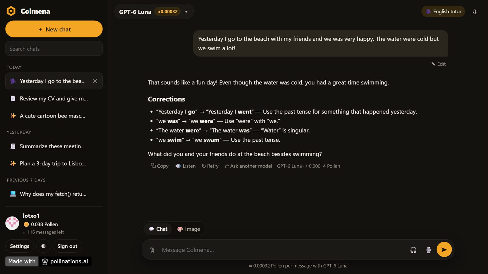

# Colmena — every AI model in one place

[](https://pollinations.ai/?ref=badge)

**Live app:** https://lotxo1.github.io/colmena/



Colmena is a multi-model AI studio built on [Pollinations](https://pollinations.ai). Sign in with your Pollinations account and pay per message with your own Pollen. No subscription, no server, no ads, no tracking.

## Features

- **30+ text models** (GPT-6, GPT-5.5, DeepSeek, Grok, Kimi, Mistral, Llama, Qwen… plus Claude and Gemini for accounts with paid Pollen), streaming answers, Markdown and code highlighting
- **Ask another model**: re-ask any question to a different model and compare the answers in place
- **Prices you can read**: every model shows its cost per message and how many messages one Pollen covers; every answer shows what it actually cost; the sidebar shows how many messages your balance covers
- **Images**: create images (square, landscape or portrait) or attach a photo and describe how to change it (edit-capable models are picked automatically)
- **Files**: attach PDF, Word (.docx) or text/code files and ask about them; text is extracted in the browser
- **Vision**: attach or paste a picture and ask about it
- **Voice**: dictate with the microphone (Whisper), hear answers read aloud (6 voices), or turn on voice mode for a spoken conversation
- **Assistants**: English tutor, CV reviewer, homework helper, translator, writer, summarizer and coder, each with one-click example prompts
- **Your own assistants**: create one with your instructions and share it with a link; whoever opens the link can add it
- **Speaks your language**: answers in the language you write; interface in English, Spanish, Portuguese, French and Indonesian
- **Private by design**: chats are stored only in your browser (IndexedDB); export to Markdown or delete anytime
- Installable as an app (PWA), works on phones, light and dark themes

## How it works

- Sign-in uses Pollinations **Connect User Wallets** (OAuth authorization code flow with PKCE, no backend). The app asks for the `text`, `image` and `audio` model categories and the `profile` + `usage` scopes (to show your name and balance). You choose the spending limit on the consent screen.
- Only the public App Key (`pk_…`) is in the code. The session key is kept for the tab, or on the device if "Keep me signed in" is on. It is budget-capped and can be revoked at [enter.pollinations.ai](https://enter.pollinations.ai).
- Security: strict Content Security Policy, Subresource Integrity on CDN scripts, sanitized Markdown, and images from unknown sites are shown as links instead of being loaded (prevents data leaks through prompt injection).

## Run locally

It's a static site. Serve the folder on `http://localhost:5178/` (registered as a redirect URI) and open it:

```bash
npx serve -l 5178 .
```

## Tech

Plain HTML, CSS and JavaScript, no build step. [marked](https://marked.js.org/), [DOMPurify](https://github.com/cure53/DOMPurify), [highlight.js](https://highlightjs.org/), [PDF.js](https://mozilla.github.io/pdf.js/) and [mammoth](https://github.com/mwilliamson/mammoth.js) from cdnjs.

## License

MIT
